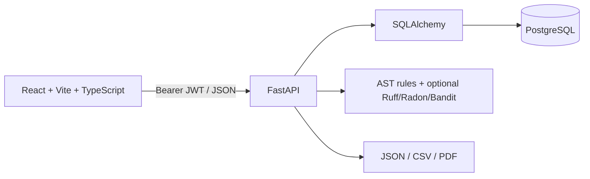

# DevShield — Intelligent Code Quality, Security & Bug Risk Analyzer

**Analyze Smarter. Debug Faster. Ship Confidently.**

DevShield is a full-stack static-analysis portfolio project. It combines a React + TypeScript workspace with a FastAPI API, PostgreSQL persistence, password hashing/JWT auth, Python AST rules, optional Ruff/Radon/Bandit integrations, heuristic risk scoring, scan history and JSON/CSV/PDF reports. Submitted code is analyzed as text and is never executed.

## Architecture



## Folder map

- `client/`: Vite React application, route-aware pages, API client and plum/copper design system.
- `server/app/`: API, models, authentication, analyzer, risk engine and reports.
- `server/alembic/`: migration configuration and initial migration scaffold.
- `server/tests/`: API and analyzer tests.
- `docker-compose.yml`: PostgreSQL, API and frontend services.

## Requirements

- Python 3.12 recommended (3.11+ supported by current dependencies)
- Node.js 20+ and npm
- PostgreSQL 15+ OR Docker Desktop
- VS Code recommended

## Quick start — Windows PowerShell

1. Extract `DevShield-Complete-Project.zip`, then open the `devshield` folder in VS Code.
2. Copy environment template: `Copy-Item .env.example .env` and edit `SECRET_KEY` and `DATABASE_URL`.
3. Start PostgreSQL. Easiest: `docker compose up -d db`. Default local database values are shown in the compose file; change them before sharing/deployment.
4. Backend terminal:

```powershell
cd server
py -3.12 -m venv .venv
.venv\Scripts\Activate.ps1
python -m pip install --upgrade pip
pip install -r requirements.txt
# From repository root, copy .env.example to .env; the API loads it when started from root.
python -m uvicorn app.main:app --reload --app-dir .
```

5. Frontend terminal:

```powershell
cd client
npm install
npm run dev
```

6. Open `http://localhost:5173`. API docs: `http://localhost:8000/docs`; health check: `http://localhost:8000/health`.

### CMD differences

Use `copy .env.example .env`, and activate the environment with `.venv\Scripts\activate.bat`. Other commands are the same.

## Docker setup

```powershell
Copy-Item .env.example .env
docker compose up --build
```

Frontend: `http://localhost:5173`; API: `http://localhost:8000/docs`. The compose file is a development setup, not a hardened production deployment. Configure secrets, TLS, storage, backups, and restrictive network policies before production.

## Configuration

| Variable | Purpose |
|---|---|
| `APP_NAME` | API title |
| `ENVIRONMENT` | environment label |
| `SECRET_KEY` | JWT signing secret; use a unique high-entropy value |
| `DATABASE_URL` | SQLAlchemy PostgreSQL URL |
| `ACCESS_TOKEN_MINUTES` | access token lifetime |
| `CORS_ORIGINS` | comma-separated allowed frontend origins |
| `UPLOAD_DIR` | local private storage directory |

## Features implemented

- Registration, login, current-user endpoint, password hashing and signed bearer tokens.
- User-owned projects and persistent scans/findings.
- Python AST checks for `eval`, hardcoded credential-like assignments, broad exception handlers, long functions, deep nesting, missing docstrings and SQL string construction patterns.
- Optional Ruff, Radon and Bandit integrations when installed; the API records tool availability.
- Cyclomatic complexity approximation, maintainability proxy, transparent heuristic bug-risk score, recommendations and scan comparison.
- Dashboard and trend APIs; scan history; JSON, CSV and PDF report exports.
- Plum/rose/copper/charcoal UI only; no blue or green UI palette.

## API overview

- Auth: `/api/auth/register`, `/api/auth/login`, `/api/auth/me`
- Projects: `/api/projects` and `/api/projects/{id}`
- Scans: `/api/scans`, `/api/scans/{id}`, `/api/scans/{id}/findings`, `/api/scans/{id}/metrics`
- Analytics: `/api/analytics/dashboard`, `/api/analytics/trends`, `/api/analytics/code-health`
- Comparison: `/api/compare?scan_a=UUID&scan_b=UUID`
- Reports: `/api/reports`, `/api/reports/{id}/download`
- Account: `/api/users/me`, `/api/settings`
- Admin endpoints are role-gated. Full OpenAPI details are available at `/docs`.

## Database and migrations

SQLAlchemy creates the initial tables at application startup for an easy local first run. Alembic configuration is included for migration-based evolution; create revisions with `alembic revision --autogenerate -m "describe change"` from `server/` and apply with `alembic upgrade head` after configuring `DATABASE_URL`.

## Tests and checks

Backend: from `server/`, activate the venv and run `pytest -q`. Frontend: from `client/`, run `npm test`, `npm run lint`, and `npm run build`. CI workflow runs backend tests and frontend checks. Test results depend on your installed runtime and database configuration.

## Security design and limitations

- Passwords use Argon2; API tokens are signed and expire. This starter uses bearer access tokens and does not yet implement rotating HttpOnly refresh cookies, CSRF, email verification/reset delivery, a distributed queue, or comprehensive rate limiting.
- Code is parsed/scanned as text; it is not run. Optional third-party scanner subprocesses receive temporary source text and strict timeouts, but hardened production isolation (network-disabled containers, seccomp, resource quotas) must be added before accepting hostile multi-tenant workloads.
- Python custom rules are supported. JS/TS/Java analysis is only available when a compatible Semgrep installation and rules are configured; no full coverage is claimed.
- The risk score is an explainable heuristic, not validated machine learning. Findings are potential risks, not proof of exploitability.
- Local file storage is suitable for development; use private object storage, retention controls and backups for production.

## Resume description

**DevShield — Full-Stack Code Quality & Security Analyzer:** Built a React/TypeScript and FastAPI application with PostgreSQL persistence, JWT/Argon2 authentication, AST-based static checks, complexity and heuristic risk scoring, scan history, comparisons, analytics and downloadable reports.

## Screenshots

Add screenshots of your locally running app here after testing.
